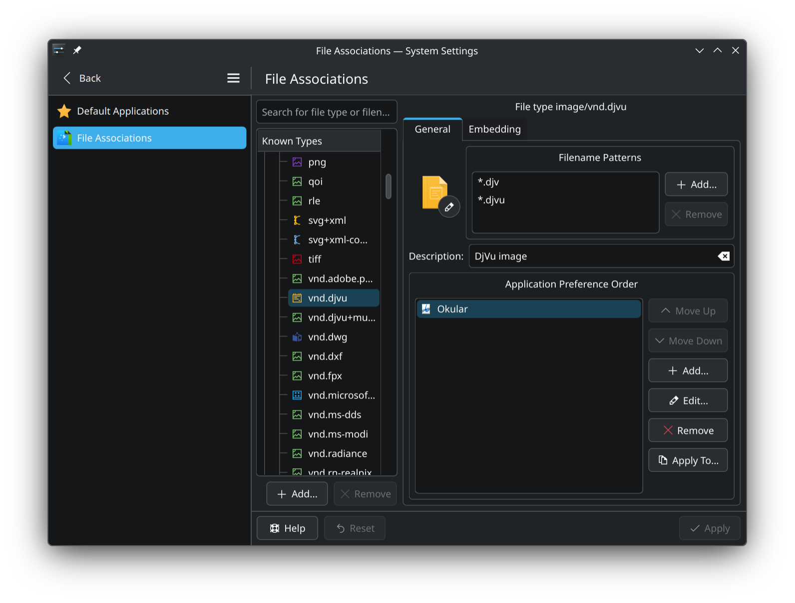

书接<a href="/archives/789/" title="快捷方式.exe">上回</a> 😾

切换到Linux后，我原来精心设置的打开方式又丢失了 😾

XDG MIME文件关联是个庞大复杂混乱迂回麻烦的系统，创建文件关联需要先编写XML和像INI一样的东西各一团，在其中胡编乱造MIME类型，用它们更新MIME数据库和快捷方式数据库，最后在用户个人偏好里执行关联。KDE系统设置提供的文件关联编辑界面的复杂度是对XDG MIME关联系统复杂度的直接反映。

因为太过复杂，我已经懒得修改文件关联了。

在这一点上我甚是想念Windows 3.1，能无比直接地编辑“扩展名 → 可执行文件名”形式的文件关联。

不得不追溯到如此远古版本的原因是，微软从Windows XP开始就已经在搞屎化了 😾

<figure>
	
	<figcaption>
		在Windows XP上打开未知类型的文件时弹出的对话框，默认选项是“使用Web服务查找正确的程序”。来自文章<a href="https://movq.de/blog/postings/2026-06-20/0/POSTING-en.html">Windows UI evolution: Clicking an unassociated file</a>
	</figcaption>
</figure>

“使用Web服务查找正确的程序”能不能排到Windows史上最搞笑功能前十呢……想必还不够格。

我也未曾完全理解Windows 2000时代的文件关联设置面板。

<figure>
	
	<figcaption>
		Windows 2000文件夹选项中的文件关联选项卡。来自文章<a href="https://invisibleup.com/articles/34/">The Perils of File Typing</a>
	</figcaption>
</figure>

点击“更改”按钮选择另一个程序后，文件关联确实会被修改，但“高级”按钮会变成“还原”。

	
	

什么意思？用户自定义的关联就是比安装的关联低人一等呗 😾

以上内容与Firefox没有关系。Firefox 153开发者工具新增了模拟本地静态服务器的功能，可在开发者工具设置页添加域名映射。模拟的网站可以通过HTTP和HTTPS协议访问，以方便使用强制要求安全😾上下文的web API。这些子域名仅在开发者工具开着的时候生效。

感觉好像有点用，但有用不太可能 😾

该功能的文档见[Firefox Source Docs](https://firefox-source-docs.mozilla.org/devtools-user/local_mode/index.html)。Firefox 153目前在beta版和开发者版更新渠道可用。
