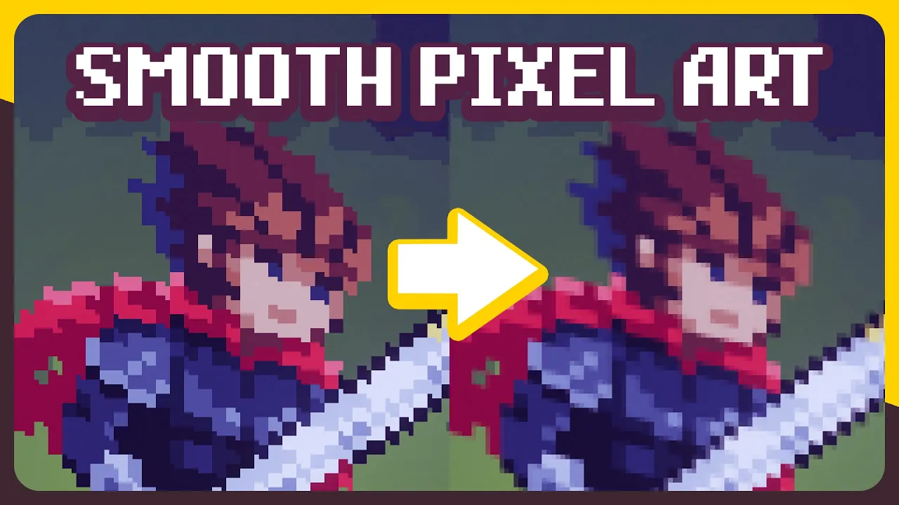

我初次使用SDL是在2.0发布不久，大概是2.0.4版本。那时[Lazy Foo网站](https://lazyfoo.net/)还是等宽字体，只有完整的SDL 1.2教程，2.0教程还没做完。SDL2为了支持硬件图形渲染，彻底改变了窗口绘制方式，老教程需要大改。我只好找零散的新资料学习。

印象里当时针对SDL2有一些批评声，认为surface和texture两套接口使SDL丧失了简洁性，Simple DirectMedia Layer不再simple了。现在看来，对于GPU这样的烂摊子😾，不管怎么处理都会被骂吧……

我写了一些简单的UI代码，比如绘制9-patch。很快发现了问题：不知道怎么绘制平铺纹理。最后结论是用SDL2的2D渲染器只能一块一块拼 😾 后来我了解到平铺纹理应该用着色器实现，但SDL2的渲染器只提供预制着色器，功能残废。其实大家都明白这一点，没人用内置的2D渲染器，只把SDL当作GL启动器来用 😾

去年年初，SDL3的首个正式版本3.2.0对外发布了。SDL3添加了真正的GPU支持，可以运行平台特定的着色器代码了。你醒啦，可现在已经是wgpu的时代了 😾 不过更令我惊喜的是，在我关注的用例上，内置的2D渲染器得到了大幅加强。

<dl class=long>
<dt>SDL_RenderTexture(9Grid)?(Tiled)?
<dd>

2D渲染器终于加上了绘制平铺图案的功能。甚至连绘制9-patch的函数都内置了，于3.4.0版本补齐了RenderTexture(9Grid)?(Tiled)?的有着十个参数的最后一块拼图（[PR](https://github.com/libsdl-org/SDL/pull/12076)）。

```c
bool SDL_RenderTexture9GridTiled(
	SDL_Renderer *renderer,
	SDL_Texture *texture,
	const SDL_FRect *srcrect,
	float left_width,
	float right_width,
	float top_height,
	float bottom_height,
	float scale,
	const SDL_FRect *dstrect,
	float tileScale
);
```

<dt>SDL_SCALEMODE_PIXELART
<dd>

SDL 3.4.0给2D渲染器添加了第三种图像插值方法SDL_SCALEMODE_PIXELART。

前情提要：GPU渲染图像的采样算法只能在最近邻和双线性中二选一。大多数画风只要选择双线性就好了，但像素画是个例外。长期以来，像素风游戏和应用程序最方便的选择只有最近邻，不能正确处理非整数缩放和抗锯齿。

要想解决这些问题，需要写一段不是很容易写对的着色器代码。2023年，@<pouting-cat>t3ssel8r的SoME3投稿作品<a href="https://www.youtube.com/watch?v=d6tp43wZqps" lang=en>Crafting a Better Shader for Pixel Art Upscaling</a>动画解说支持任意变形的像素画采样算法原理，这种技术才为人熟知。

<figure>

<figcaption>
<cite lang=en>Crafting a Better Shader for Pixel Art Upscaling</cite>视频封面
</figcaption>
</figure>

SDL3把这一技术包装为了易用的形式（参照：[What does SDL\_SCALEMODE\_PIXELART do?](https://github.com/libsdl-org/SDL/issues/12836)），可以期待很远的将来有更多良好支持像素画非整数缩放的应用出现。

<dt>SDL_ComposeCustomBlendMode
<dd>

SDL2最初只支持加法、乘法等极为有限的少数几种混合模式。2.0.6版本新增了[SDL\_ComposeCustomBlendMode](https://wiki.libsdl.org/SDL3/SDL_ComposeCustomBlendMode)，以一种神秘方式支持了更多混合模式。

<!----><math display="block"><mi>dstRGB</mi><mo>=</mo><mi>colorOperation</mi><mo>(</mo><mi>srcRGB</mi><mo>×</mo><mi>srcColorFactor</mi><mo>,</mo><mi>dstRGB</mi><mo>×</mo><mi>dstColorFactor</mi><mo>)</mo></math>

<!----><math display="block"><mi>dstA</mi><mo>=</mo><mi>alphaOperation</mi><mo>(</mo><mi>srcA</mi><mo>×</mo><mi>srcAlphaFactor</mi><mo>,</mo><mi>dstA</mi><mo>×</mo><mi>dstAlphaFactor</mi><mo>)</mo></math>

其中各Operation可以是加法、减法（两种方向）、最小值、最大值，各Factor可以是0、1、某图层颜色、某图层不透明度。Factor可以取反。

</dl>

除此之外，SDL3各方面功能都变得更加全面，删除了许多意义不明的东西（SDLmain 😾 SDL\_bool 😾），还大幅改善了文档。调用它的API成了一件快乐的事。

我会喜欢每一个存在了数十年而主版本号只有3，新增功能致力于解决真实需求，还有详尽迁移指南的软件。Vue.js和Python：报我身份证？但不要忘了，SDL还提供……

<dl class=long>
<dt><a href="https://github.com/libsdl-org/SDL/blob/release-3.4.4/include/SDL3/SDL_oldnames.h">SDL_oldnames.h</a>用最原始的方式助力迁移
<dd>比如说，<code>#define SDL_WINDOW_SHOWN SDL_WINDOW_SHOWN_deprecated_windows_are_shown_by_default</code>
<dt>自动化迁移脚本和Coccinelle语义补丁
<dd>自动化迁移脚本是用Python写的，比SDL本体更容易遭到破坏性变更 😾
<dt><a href="https://wiki.libsdl.org/SDL3/SDL12MigrationGuide">从SDL 1.2直升3.0的迁移指南</a>
<dd>正篇第一句话甚至是<span lang=en>“Do you <em>need</em> to migrate?”</span>，因为有……
<dt>ABI兼容层sdl12-compat和sdl2-compat
<dd>应用程序无需重新编译就可直接基于新版库运行
</dl>

最后但也许更为重要的：在今天，能把下面这段文字提交进仓库的项目，只恐怕已是凤毛麟角。

<figure lang=en>
<blockquote>
<p>We want our code to be art. We want to interact with real humans. Please don't submit AI-generated comments or code in bug reports or pull requests. We understand some people consider AI to be a useful tool, but we want to connect with you, not your computer.
</blockquote>
<figcaption>SDL/<a href="https://github.com/libsdl-org/SDL/blob/release-3.4.16/AGENTS.md">AGENTS.md</a></figcaption>
</figure>
