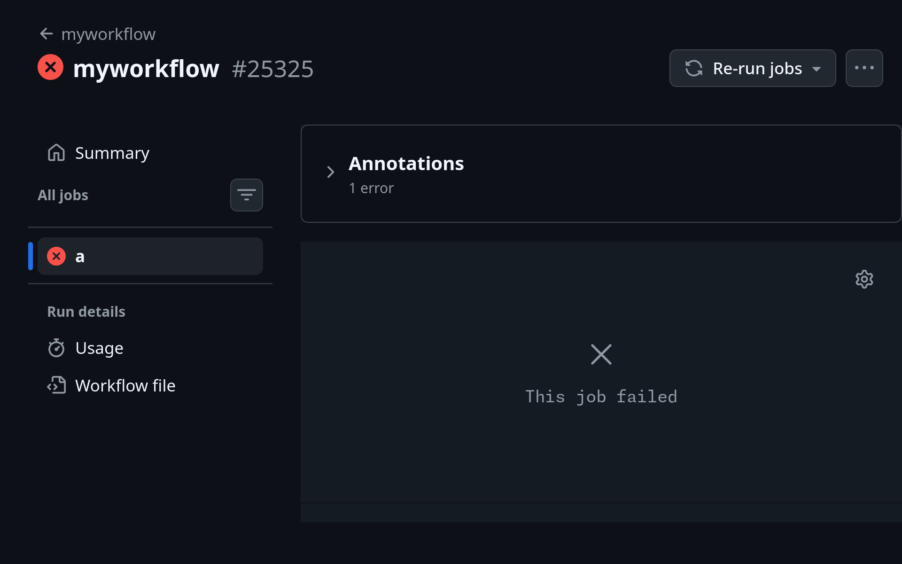
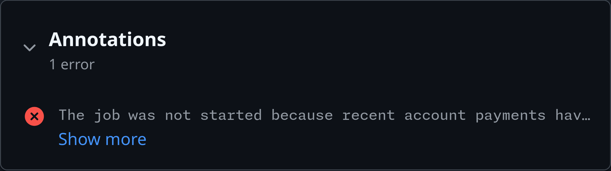
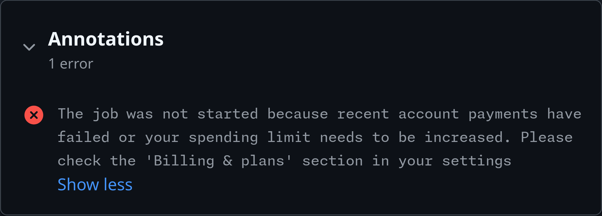
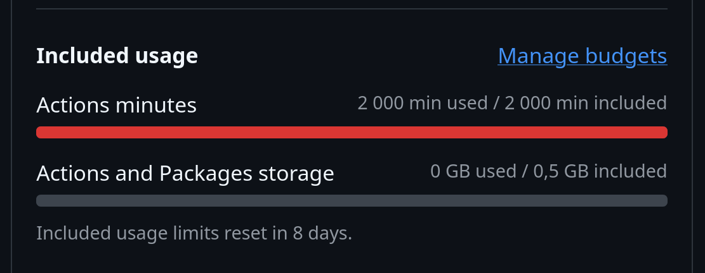
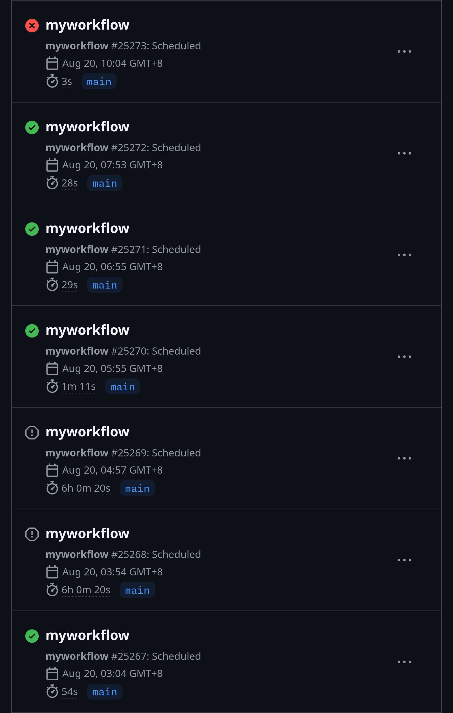
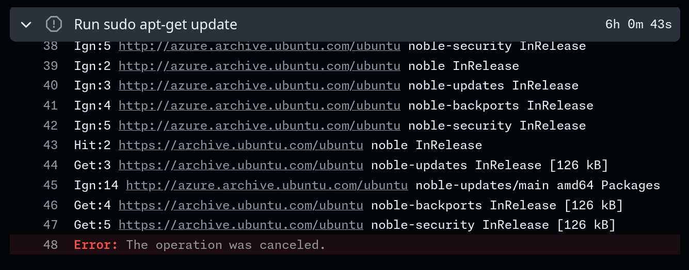
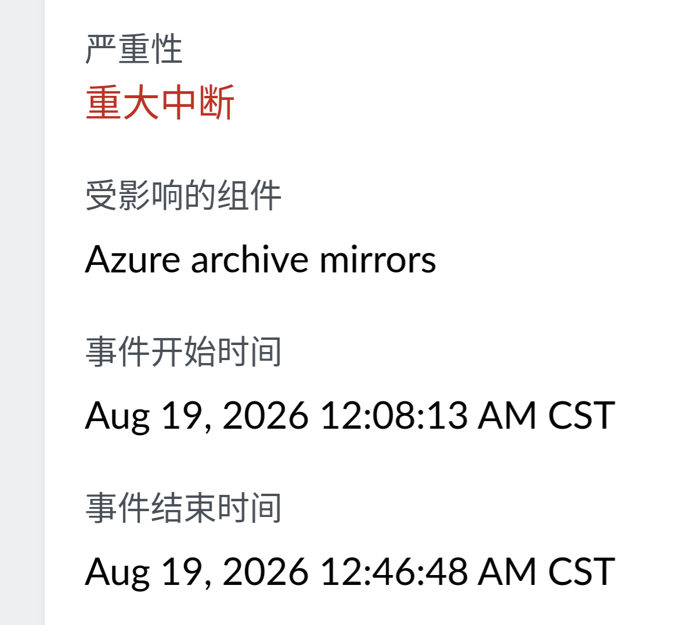

---
tags:
- GitHub
---

今天我突然收到了一大堆GitHub actions报错通知。点开一看，也不知道到底报了什么错，就一个光秃秃的“This job failed” 😾

必须点击“Annotations”左侧仅有16px见方的“<svg class="icon" viewBox="0 0 16 16"><path d="M6.22 3.22a.75.75 0 0 1 1.06 0l4.25 4.25a.75.75 0 0 1 0 1.06l-4.25 4.25a.751.751 0 0 1-1.042-.018.751.751 0 0 1-.018-1.042L9.94 8 6.22 4.28a.75.75 0 0 1 0-1.06Z" fill="currentColor"/></svg>”，然后再点击“Show more”才能展开完整的报错信息。点击粗体的Annotations字样没有任何反应。GitHub的UI真是太好用了 😾

GitHub actions对公开仓库免费，私有仓库每月有2000分钟Linux额度，Windows和macOS用量按比例成倍折算。报错确实发生在私有仓库里，可什么叫我的免费额度突然用完了？

我检查了actions用量，竟然真的用完了。

往前翻了几页运行记录，找到了额度还没用完时的情况，发现一些任务运行到一半卡死了，一直运行了6小时才被超时中止，很快就把额度用满了。

日志显示，仅仅运行了一下`apt-get update`就卡死了。

Canonical and Ubuntu Status页面显示，前几日似乎确有相应的[爆炸情况](https://status.canonical.com/#/incident/KNms6QK9ewuzz-7xUsPsNylV20jEt5kyKsd8A-3ptQFOu2JWLS6XgaV2r1lByK_Q_aL1AIfEJMcICbDK9YdODQ%3D%3D)，但时间对不上。

GitHub Status……没有报告。得了吧，就算真炸了他们也不会承认的 😾

为了避免此类问题再度发生，我给所有定时运行的私有仓库actions都加上了几分钟的超时。
